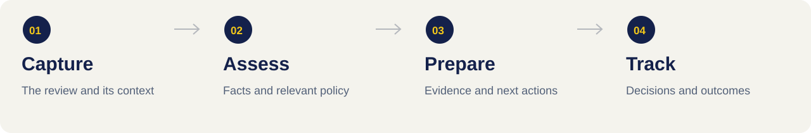

# Reviewell — product brief

[Organisation home](https://github.com/reviewell-app) · [Website and enquiries](https://reviewell.com)

## The problem

A business disputing a review often has several separate pieces of work: understand what happened, identify the relevant facts, gather evidence, decide whether a challenge is appropriate and follow the response. Scattered messages and documents make those decisions harder to explain and track.

Reviewell is building a structured workspace around that casework. This brief describes the product direction, not a promise that every capability is currently available. Service availability and onboarding are communicated through the website.

## Who it is for

| Person | Their task | A useful result |
| :--- | :--- | :--- |
| Business owner | Explain a disputed review and respond to relevant evidence requests | A clear understanding of the case and next step |
| Agency | Coordinate cases for its clients | Organised context, responsibilities and progress |
| Caseworker | Assess the facts, prepare work and record decisions | A traceable case history with a defensible rationale |

## The casework model

### 1. Capture context

Establish which review is being discussed, what the business says happened and which information is missing. Separate the original review from the business's explanation and any assumptions.

### 2. Assess the facts

Consider the available facts and the relevant platform guidance. A negative review, an unverified allegation and an established policy breach are different things; the record should distinguish them.

### 3. Prepare relevant evidence

Identify what is needed to support the next decision. Keep requests specific and record where evidence came from. A person should review any proposed external action with the appropriate authority.

### 4. Track decisions and outcomes

Record what was decided, what was communicated and what response was received. Distinguish a request, an attempted action and a confirmed outcome. Keep the case history understandable to the next person who works on it.

## An illustrative case

This is a fictional example of the intended workflow, not a customer testimonial or a platform-policy determination.

| Stage | What happens |
| :--- | :--- |
| Intake | A business says it cannot identify the experience described in a review. |
| Open question | The case records the business's statement without treating it as proof that the review is false. |
| Evidence request | The caseworker asks for narrowly relevant context and documents what is available. |
| Decision | A person considers whether the facts support further action, a response or no challenge. |
| Follow-up | Any action and platform response are recorded as facts, with the next step made clear. |

## Product boundaries

- Assessment and preparation do not guarantee removal. A platform makes its own decisions.
- Public GitHub issues are for engineering collaboration, not customer evidence or private correspondence.
- This public organisation profile does not provide access to private customer workspaces or product source code.

## Where to go next

For business enquiries, start at [reviewell.com](https://reviewell.com). For technical collaboration, read the [contribution guide](../CONTRIBUTING.md) and [engineering handbook](ENGINEERING.md). For security concerns, use the [private reporting instructions](../SECURITY.md).
